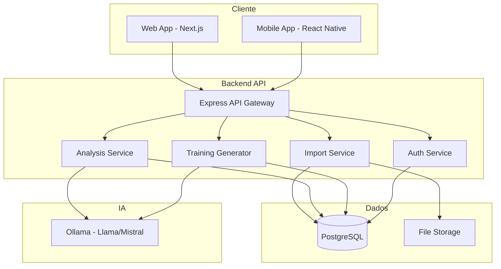
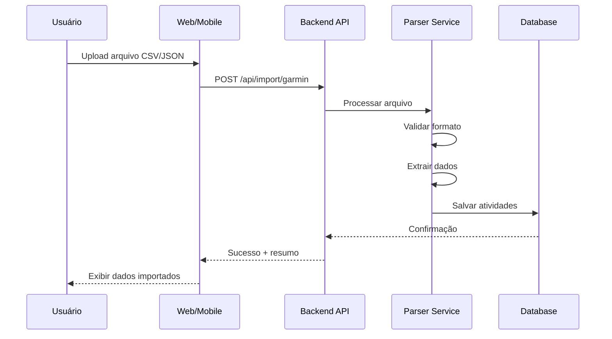
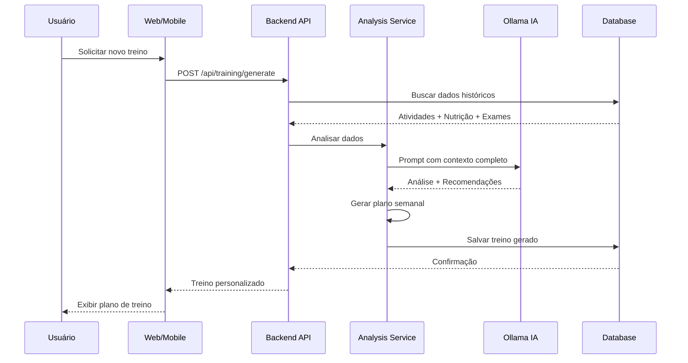

# Arquitetura do Sistema - Garmin Training AI

## Visão Geral

Sistema multiplataforma para análise de dados de treino do Garmin Connect, correlação com dados nutricionais e exames físicos, gerando treinos personalizados usando IA local.

## Stack Tecnológico

### Backend
- **Runtime**: Node.js 20+
- **Framework**: Express.js
- **Linguagem**: TypeScript
- **Banco de Dados**: PostgreSQL 15+
- **ORM**: Prisma
- **IA Local**: Ollama (Llama 3 ou Mistral)
- **Validação**: Zod
- **Autenticação**: JWT + bcrypt

### Frontend Web
- **Framework**: Next.js 14+ (App Router)
- **Linguagem**: TypeScript
- **UI Library**: React 18+
- **Estilização**: Tailwind CSS + shadcn/ui
- **Gráficos**: Recharts ou Chart.js
- **Estado**: Zustand ou React Query
- **Formulários**: React Hook Form + Zod

### Mobile
- **Framework**: React Native + Expo
- **Linguagem**: TypeScript
- **Navegação**: React Navigation
- **UI Components**: React Native Paper ou NativeBase
- **Estado**: Zustand

### DevOps
- **Containerização**: Docker + Docker Compose
- **CI/CD**: GitHub Actions
- **Deploy**: Kubernetes (opcional) ou Docker Swarm
- **Monitoramento**: Prometheus + Grafana (futuro)

## Arquitetura do Sistema



## Estrutura de Diretórios

```
garmin-training-ai/
├── packages/
│   ├── backend/                 # API Backend
│   │   ├── src/
│   │   │   ├── config/         # Configurações
│   │   │   ├── controllers/    # Controllers REST
│   │   │   ├── services/       # Lógica de negócio
│   │   │   ├── models/         # Modelos Prisma
│   │   │   ├── middleware/     # Middlewares
│   │   │   ├── utils/          # Utilitários
│   │   │   ├── parsers/        # Parsers CSV/JSON
│   │   │   ├── ai/             # Integração IA
│   │   │   └── index.ts        # Entry point
│   │   ├── prisma/
│   │   │   └── schema.prisma   # Schema do banco
│   │   ├── tests/
│   │   ├── Dockerfile
│   │   └── package.json
│   │
│   ├── web/                     # Frontend Web
│   │   ├── src/
│   │   │   ├── app/            # App Router Next.js
│   │   │   ├── components/     # Componentes React
│   │   │   ├── lib/            # Utilitários
│   │   │   ├── hooks/          # Custom hooks
│   │   │   ├── services/       # API clients
│   │   │   └── types/          # TypeScript types
│   │   ├── public/
│   │   ├── Dockerfile
│   │   └── package.json
│   │
│   ├── mobile/                  # App Mobile
│   │   ├── src/
│   │   │   ├── screens/        # Telas
│   │   │   ├── components/     # Componentes
│   │   │   ├── navigation/     # Navegação
│   │   │   ├── services/       # API clients
│   │   │   ├── hooks/          # Custom hooks
│   │   │   └── types/          # TypeScript types
│   │   ├── app.json
│   │   └── package.json
│   │
│   └── shared/                  # Código compartilhado
│       ├── types/              # Types compartilhados
│       ├── utils/              # Utilitários
│       └── constants/          # Constantes
│
├── docker-compose.yml
├── .github/
│   └── workflows/
├── docs/                        # Documentação
└── README.md
```

## Modelos de Dados

### Usuário
```typescript
User {
  id: string
  email: string
  password: string (hash)
  name: string
  createdAt: DateTime
  updatedAt: DateTime
}
```

### Dados Garmin
```typescript
GarminActivity {
  id: string
  userId: string
  activityType: string (corrida, ciclismo, natação, etc)
  date: DateTime
  duration: number (minutos)
  distance: number (km)
  calories: number
  avgHeartRate: number
  maxHeartRate: number
  avgPace: number
  elevation: number
  trainingEffect: number
  vo2max: number?
  rawData: JSON (dados completos do CSV)
  createdAt: DateTime
}

GarminMetrics {
  id: string
  userId: string
  date: DateTime
  restingHeartRate: number
  hrv: number (variabilidade)
  sleepHours: number
  sleepQuality: number
  stress: number
  bodyBattery: number
  steps: number
  createdAt: DateTime
}
```

### Plano Nutricional
```typescript
NutritionPlan {
  id: string
  userId: string
  name: string
  startDate: DateTime
  endDate: DateTime?
  dailyCalories: number
  macros: JSON {
    protein: number (g)
    carbs: number (g)
    fat: number (g)
  }
  meals: JSON[]
  notes: string?
  createdAt: DateTime
  updatedAt: DateTime
}

NutritionLog {
  id: string
  userId: string
  date: DateTime
  meal: string
  calories: number
  protein: number
  carbs: number
  fat: number
  notes: string?
  createdAt: DateTime
}
```

### Exames Físicos
```typescript
PhysicalExam {
  id: string
  userId: string
  examDate: DateTime
  examType: string
  results: JSON {
    weight: number
    height: number
    bodyFat: number
    muscleMass: number
    bloodPressure: {systolic: number, diastolic: number}
    bloodTests: {
      hemoglobin: number
      glucose: number
      cholesterol: {total, hdl, ldl}
      triglycerides: number
      // outros marcadores
    }
  }
  doctorNotes: string?
  attachments: string[] (URLs)
  createdAt: DateTime
}
```

### Treinos Gerados
```typescript
GeneratedTraining {
  id: string
  userId: string
  generatedAt: DateTime
  weekStartDate: DateTime
  weekEndDate: DateTime
  goal: string
  aiAnalysis: JSON {
    currentFitness: string
    recommendations: string[]
    warnings: string[]
  }
  weeklyPlan: JSON[] {
    day: number
    workouts: [{
      type: string
      duration: number
      intensity: string
      description: string
      targetHeartRate: {min, max}
      notes: string
    }]
  }
  nutritionAdjustments: JSON?
  status: string (pending, active, completed)
  userFeedback: string?
  createdAt: DateTime
  updatedAt: DateTime
}
```

## Fluxo de Dados

### 1. Importação de Dados



### 2. Geração de Treino



## APIs Principais

### Autenticação
- `POST /api/auth/register` - Registro de usuário
- `POST /api/auth/login` - Login
- `POST /api/auth/refresh` - Refresh token
- `POST /api/auth/logout` - Logout

### Importação
- `POST /api/import/garmin/activities` - Importar atividades
- `POST /api/import/garmin/metrics` - Importar métricas diárias
- `POST /api/import/nutrition` - Importar plano nutricional
- `POST /api/import/exam` - Importar exame físico
- `GET /api/import/history` - Histórico de importações

### Dados
- `GET /api/activities` - Listar atividades
- `GET /api/activities/:id` - Detalhes de atividade
- `GET /api/metrics` - Métricas diárias
- `GET /api/nutrition/plans` - Planos nutricionais
- `GET /api/exams` - Exames físicos

### Análise e Treinos
- `POST /api/training/generate` - Gerar novo treino
- `GET /api/training/current` - Treino atual
- `GET /api/training/history` - Histórico de treinos
- `PUT /api/training/:id/feedback` - Feedback do treino
- `GET /api/analysis/dashboard` - Dashboard com análises

### Dashboard
- `GET /api/dashboard/overview` - Visão geral
- `GET /api/dashboard/trends` - Tendências
- `GET /api/dashboard/correlations` - Correlações

## Integração com IA Local (Ollama)

### Configuração
```typescript
// Ollama rodando localmente na porta 11434
const OLLAMA_URL = 'http://localhost:11434'
const MODEL = 'llama3' // ou 'mistral'

// Exemplo de prompt para análise
const analysisPrompt = `
Você é um especialista em treinamento esportivo e nutrição.

Dados do atleta:
- Atividades recentes: ${activities}
- Métricas de saúde: ${metrics}
- Plano nutricional: ${nutrition}
- Último exame físico: ${exam}

Analise estes dados e forneça:
1. Avaliação do nível de condicionamento atual
2. Identificação de padrões e tendências
3. Correlações entre treino, nutrição e saúde
4. Recomendações para otimização
5. Alertas sobre possíveis riscos

Formato de resposta: JSON estruturado
`
```

### Prompts Especializados

1. **Análise de Condicionamento**
2. **Geração de Treino Semanal**
3. **Ajustes Nutricionais**
4. **Prevenção de Lesões**
5. **Otimização de Recuperação**

## Segurança

- Autenticação JWT com refresh tokens
- Senhas com bcrypt (salt rounds: 10)
- Rate limiting nas APIs
- Validação de inputs com Zod
- CORS configurado
- Helmet.js para headers de segurança
- Sanitização de dados
- HTTPS obrigatório em produção

## Performance

- Cache com Redis (futuro)
- Paginação em todas as listagens
- Índices no banco de dados
- Compressão de respostas (gzip)
- Lazy loading no frontend
- Otimização de imagens
- Code splitting

## Próximos Passos

1. Configurar estrutura do monorepo
2. Implementar backend básico
3. Criar schema do banco de dados
4. Desenvolver parsers de importação
5. Integrar Ollama
6. Criar frontend web
7. Desenvolver app mobile
8. Testes e documentação