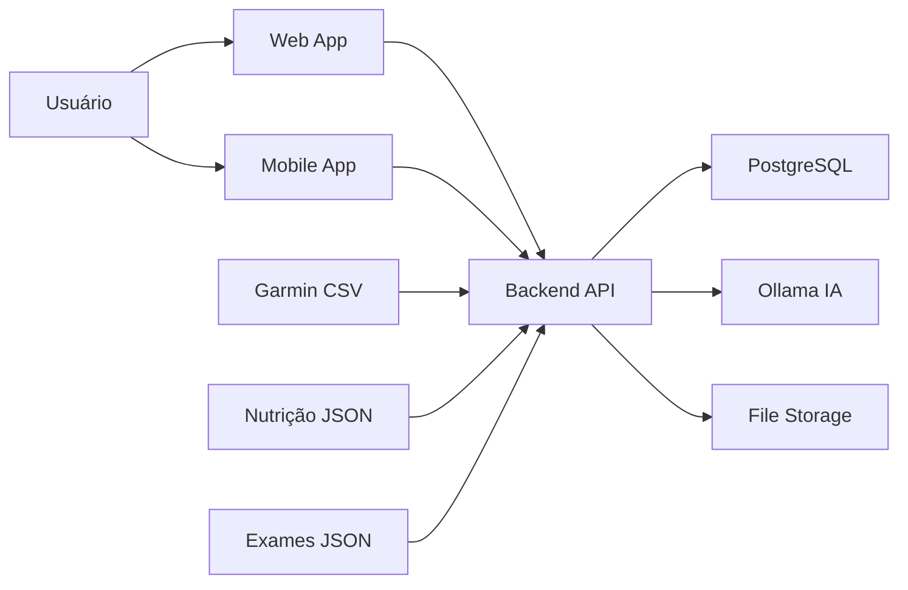
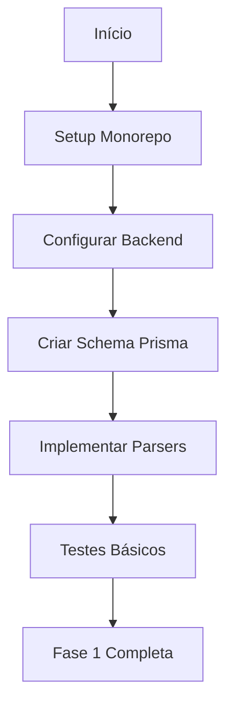
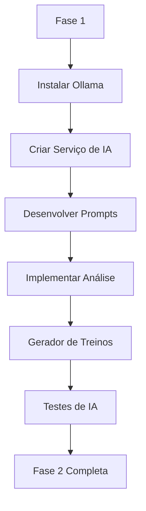
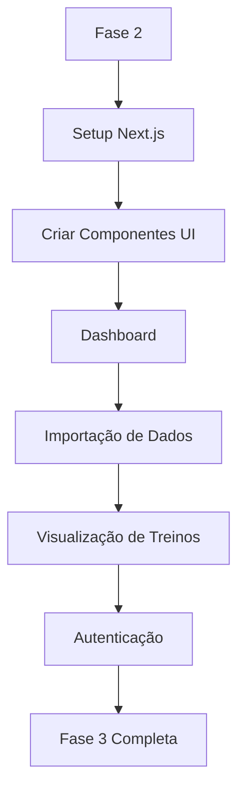
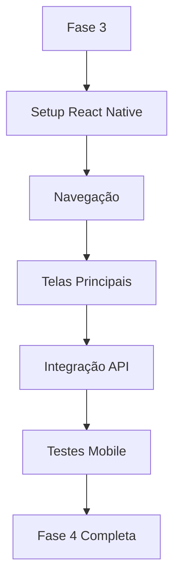
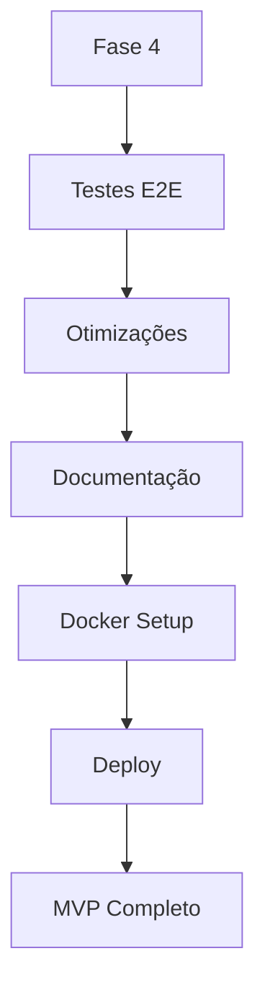
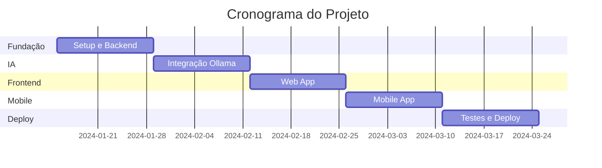
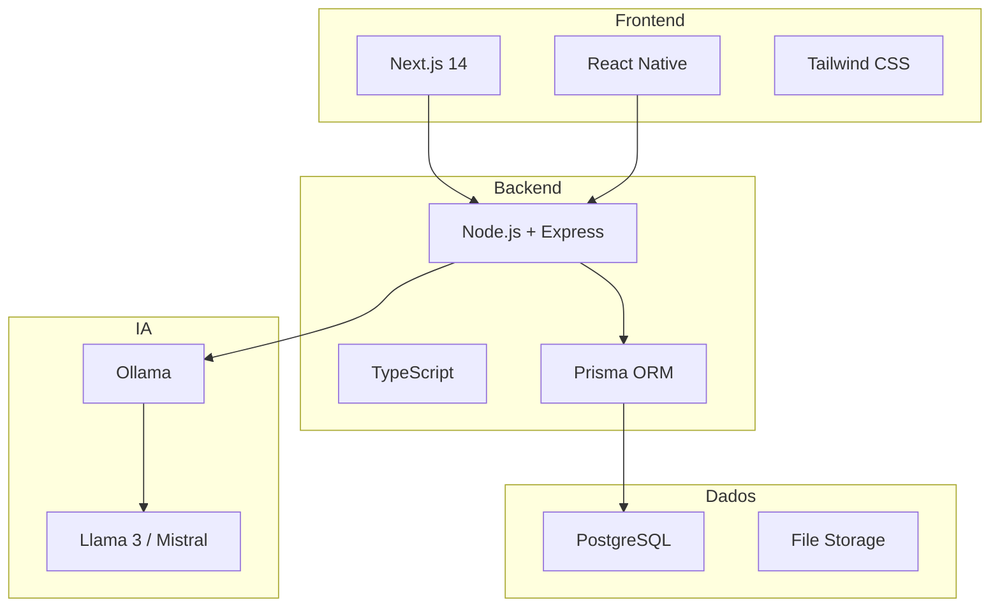

# 📋 Plano do Projeto - Garmin Training AI

## 🎯 Objetivo

Criar uma aplicação multiplataforma (Web + Mobile) que importa dados do Garmin Connect, plano nutricional e exames físicos, utilizando IA local para gerar treinos personalizados e sofisticados.

## 📊 Visão Geral do Sistema



## 🏗️ Fases de Desenvolvimento

### Fase 1: Fundação (Semanas 1-2)



**Entregas:**
- ✅ Estrutura do monorepo configurada
- ✅ Backend API básico funcionando
- ✅ Banco de dados PostgreSQL configurado
- ✅ Parsers de CSV/JSON implementados
- ✅ Testes unitários dos parsers

### Fase 2: Integração IA (Semanas 3-4)



**Entregas:**
- ✅ Ollama configurado e funcionando
- ✅ Serviço de IA integrado ao backend
- ✅ Prompts otimizados para análise
- ✅ Geração de treinos funcionando
- ✅ Testes de integração com IA

### Fase 3: Frontend Web (Semanas 5-6)



**Entregas:**
- ✅ Aplicação Next.js configurada
- ✅ Dashboard com gráficos interativos
- ✅ Interface de importação de dados
- ✅ Visualização de treinos gerados
- ✅ Sistema de autenticação

### Fase 4: Mobile App (Semanas 7-8)



**Entregas:**
- ✅ App React Native configurado
- ✅ Navegação implementada
- ✅ Telas principais funcionando
- ✅ Integração com backend
- ✅ Build para iOS e Android

### Fase 5: Refinamento e Deploy (Semanas 9-10)



**Entregas:**
- ✅ Testes end-to-end
- ✅ Otimizações de performance
- ✅ Documentação completa
- ✅ Docker e CI/CD configurados
- ✅ Deploy em produção

## 📅 Cronograma Detalhado

| Semana | Foco | Tarefas Principais | Status |
|--------|------|-------------------|--------|
| 1 | Setup Inicial | Monorepo, Backend básico, Prisma | 🔄 Pendente |
| 2 | Parsers e Dados | Importação CSV/JSON, Validação | 🔄 Pendente |
| 3 | IA - Setup | Ollama, Serviço de IA | 🔄 Pendente |
| 4 | IA - Treinos | Análise, Geração de treinos | 🔄 Pendente |
| 5 | Web - UI | Dashboard, Componentes | 🔄 Pendente |
| 6 | Web - Features | Importação, Visualização | 🔄 Pendente |
| 7 | Mobile - Setup | React Native, Navegação | 🔄 Pendente |
| 8 | Mobile - Features | Telas, Integração | 🔄 Pendente |
| 9 | Testes e Docs | E2E, Documentação | 🔄 Pendente |
| 10 | Deploy | Docker, CI/CD, Produção | 🔄 Pendente |

## 🎯 Marcos Importantes



## 🔑 Funcionalidades por Prioridade

### 🔴 Críticas (MVP)
1. ✅ Importação de dados Garmin (CSV)
2. ✅ Armazenamento em banco de dados
3. ✅ Integração com Ollama
4. ✅ Geração básica de treinos
5. ✅ Dashboard de visualização
6. ✅ Autenticação de usuários

### 🟡 Importantes (Pós-MVP)
1. ⏳ Importação de nutrição e exames
2. ⏳ Análise de correlações avançadas
3. ⏳ Gráficos interativos detalhados
4. ⏳ Histórico de treinos
5. ⏳ Exportação de relatórios

### 🟢 Desejáveis (Futuro)
1. ⏳ Integração direta com API Garmin
2. ⏳ Notificações push
3. ⏳ Compartilhamento com treinadores
4. ⏳ Análise preditiva
5. ⏳ Integração com outras plataformas

## 📊 Métricas de Sucesso

### Técnicas
- ✅ Cobertura de testes > 80%
- ✅ Tempo de resposta API < 500ms
- ✅ Tempo de geração de treino < 60s
- ✅ Uptime > 99%

### Produto
- ✅ Importação de dados funcional
- ✅ Treinos gerados com qualidade
- ✅ Interface intuitiva
- ✅ Performance aceitável

### Usuário
- ✅ Onboarding < 5 minutos
- ✅ Geração de primeiro treino < 2 minutos
- ✅ Satisfação > 4/5 estrelas

## 🛠️ Stack Tecnológico Resumido



## 📦 Dependências Principais

### Backend
```json
{
  "express": "^4.18.0",
  "prisma": "^5.0.0",
  "@prisma/client": "^5.0.0",
  "jsonwebtoken": "^9.0.0",
  "bcrypt": "^5.1.0",
  "zod": "^3.22.0",
  "axios": "^1.6.0"
}
```

### Frontend Web
```json
{
  "next": "^14.0.0",
  "react": "^18.2.0",
  "tailwindcss": "^3.4.0",
  "@tanstack/react-query": "^5.0.0",
  "recharts": "^2.10.0",
  "zustand": "^4.4.0"
}
```

### Mobile
```json
{
  "react-native": "^0.73.0",
  "expo": "^50.0.0",
  "@react-navigation/native": "^6.1.0",
  "react-native-paper": "^5.11.0"
}
```

## 🔐 Considerações de Segurança

1. **Autenticação**: JWT com refresh tokens
2. **Senhas**: Bcrypt com salt rounds adequado
3. **API**: Rate limiting e validação de inputs
4. **Dados**: Criptografia em repouso
5. **HTTPS**: Obrigatório em produção
6. **CORS**: Configurado adequadamente

## 🚀 Estratégia de Deploy

### Desenvolvimento
- Docker Compose local
- Hot reload habilitado
- Logs detalhados

### Staging
- Docker em servidor de teste
- CI/CD automatizado
- Testes E2E

### Produção
- Kubernetes ou Docker Swarm
- Load balancing
- Monitoramento
- Backups automáticos

## 📈 Próximos Passos Imediatos

1. **Agora**: Revisar e aprovar este plano
2. **Depois**: Mudar para modo Code para implementação
3. **Começar por**: Setup do monorepo e backend básico

## ❓ Perguntas Pendentes

- [ ] Qual será o domínio da aplicação?
- [ ] Onde será hospedado (AWS, GCP, Azure, VPS)?
- [ ] Haverá limite de usuários na versão inicial?
- [ ] Precisa de analytics/tracking?
- [ ] Terá versão gratuita e paga?

## 📝 Notas Importantes

- **IA Local**: Requer máquina com pelo menos 8GB RAM
- **Ollama**: Modelos ocupam 4-7GB de disco
- **PostgreSQL**: Configurar backups regulares
- **Dados Sensíveis**: Implementar LGPD/GDPR compliance
- **Performance**: Monitorar uso de recursos da IA

---

## ✅ Aprovação do Plano

Este plano está pronto para revisão. Após aprovação, podemos:

1. **Iniciar implementação** mudando para modo Code
2. **Refinar detalhes** de alguma fase específica
3. **Ajustar prioridades** conforme necessário

**Você aprova este plano e está pronto para começar a implementação?**